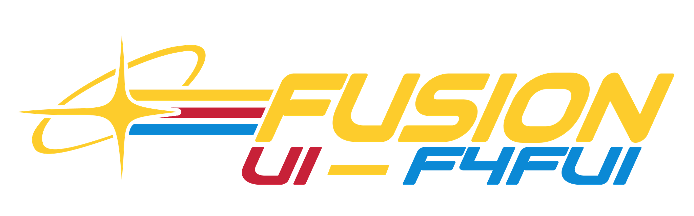

# Fusion UI



A shared Dear ImGui UI framework for Fallout 4 F4SE plugins.

Every plugin that uses it compiles its own copy in. At runtime the copies find each other, elect
one **host**, and every plugin draws as a **client** of that host. Players install nothing extra:
no web runtime, no separate framework DLL. All windows share one cursor, one input owner and one
look that follows the player's HUD colour.

Shared widgets and screens draw in **Modern, Fallout 4, Fallout 76, Skyrim, Starfield and
Fallout 3 / New Vegas** styles, switched live in **Quick settings → Appearance → Theme**.

## Icons

All icons were re-make to be faithful to their source games. No native assets are used, all are traced or drawn by hand. I tried to get them as close to accurate as possible.


## Building and testing

```
xmake f -m releasedbg -y
xmake build fusionui_tests && xmake run fusionui_tests
xmake build fusionui_preview && xmake run fusionui_preview -- --demo fo4-container --screenshot shot.png --frames 30
```

The tests cover input translation, focus, the deferred task queue, D3D11 state
save/restore (on WARP), DDS parsing, the gamepad keyboard and pointer, and the performance metric
store, lows, pin codec and capture writers.

## License

Copyright (C) 2026 Bryant-21

Fusion UI is free software: you can redistribute it and/or modify it under the terms of the GNU
General Public License as published by the Free Software Foundation, either version 3 of the
License, or (at your option) any later version (`GPL-3.0-or-later`). See [LICENSE](LICENSE).

Bundled fonts and the build dependencies keep their own licenses; see
[THIRD_PARTY.md](THIRD_PARTY.md). How AI tools were used: [AI_CONTRIBUTIONS.md](AI_CONTRIBUTIONS.md).
